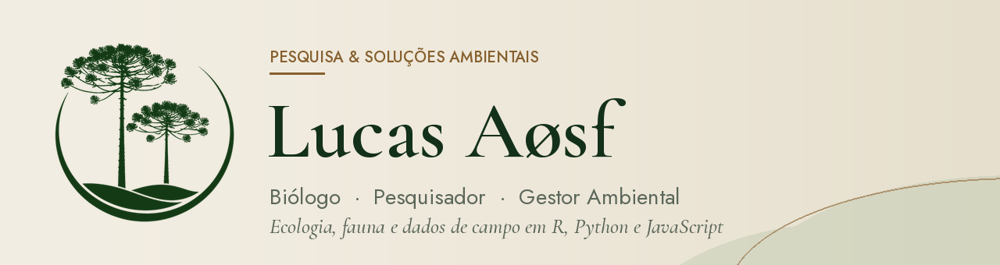

<picture>
  <source media="(prefers-color-scheme: dark)" srcset="assets/banner-escuro.png">
  
</picture>

  
  
  
  
  
  
  
  

  🌐 <b>Language / Idioma:</b>
  <b>English</b> ·
  <a href="README.pt-br.md"><b>🇧🇷 Ler em Português (Versão Completa)</b></a>

## 📊 GitHub Status // @lucasaosf

  

## 🐸 About Me

I am a **biologist, scientific researcher, environmental manager, indie maker, and passionate programmer**. I work extensively with wildlife surveys, natural history, and animal taxonomy. I use computational biology, data science, and modern web technologies to turn complex field data into statistical models, publication-grade analytics, and offline-first digital tools for field teams.

- 🌿 **Wildlife surveying & biodiversity monitoring** in major infrastructure and conservation projects
- 🔬 **Taxonomy, Systematics & Evolution** (core focus on Anuran Amphibians and Reptiles; also medium/large mammals and birds)
- 📈 **Community ecology**: species richness, abundance, diversity indices (Shannon, Simpson), similarity (Jaccard, Bray-Curtis), and rarefaction curves
- 🗺️ **Biogeographical modeling & global biodiversity databases** (GBIF data mining with R `rgbif`, eBird datasets)
- 💻 **Environmental automation & field tools**: Progressive Web Apps (PWAs) engineered to work 100% offline in remote field conditions

---

## 💻 Programming Languages

  
  
  
  
  
  

| Language | Primary Use Cases | Where |
|---|---|---|
| **R** | Multivariate ecological statistics, bioacoustics & data visualization: richness, abundance, similarity (Jaccard, Bray-Curtis), rarefaction curves, and GBIF occurrence mining | [consultoria_ambiental](https://github.com/lucasaosf/consultoria_ambiental) · [IMBio](https://github.com/lucasaosf/IMBio---Instituto-de-Manejo-da-Biodiversidade) · [M_moreirae_distribution](https://github.com/lucasaosf/M_moreirae_distribution) |
| **JavaScript** | Offline-first PWAs (*Caderneta de Campo* and *Cubagem Florestal*), botanical/faunal databases, GPS coordinate handling, and automated Excel spreadsheets | [caderneta-de-campo](https://github.com/lucasaosf/caderneta-de-campo) · [cubagem-florestal](https://github.com/lucasaosf/cubagem-florestal) |
| **HTML & CSS** | Responsive UI/UX, glassmorphism design systems, dark/light biological theme | [caderneta-de-campo](https://github.com/lucasaosf/caderneta-de-campo) · [cubagem-florestal](https://github.com/lucasaosf/cubagem-florestal) |
| **Java** | Native Android integration for field applications | Android native build (private repo) |
| **Python** | Data ETL pipelines, OS automation, and local AI agent research | [robson-assistant-teste](https://github.com/lucasaosf/robson-assistant-teste) · local scripts |

**Favorite R Packages:** `ggplot2` · `vegan` · `iNEXT` · `rgbif` · `dplyr` · `readr` · `readxl` · `openxlsx` · `cluster` · `ape` · `gridExtra`

---

## 🧰 Tools & Platforms

  
  
  
  
  
  
  
  
  

---

## 🐍 Featured Project: Caderneta de Campo (Field Notebook PWA)

Complete mobile Progressive Web App (PWA) for wildlife and botanical surveys in field operations: built-in taxonomic database with **4,903 Brazilian species**, vernacular names linked to scientific nomenclature, visual and auditory count logging, GPS waypoint tracking, and **automated technical Excel report generation** (species richness, diversity, rarefaction, similarity, Point Abundance Index). Operates **100% offline** on both Android and iPhone.

**[🚀 Launch Web App](https://lucasaosf.github.io/caderneta-de-campo/)** · **[🎥 Video Tutorial](https://lucasaosf.github.io/caderneta-de-campo/como-usar.html)** · **[📂 Source Code](https://github.com/lucasaosf/caderneta-de-campo)**

---

## 🪵 Featured Project: Cubagem Florestal (Smalian Forest Scaling)

High-precision forestry dendrometry and log scaling app for field engineers: calculates volumetric timber yield for logging trucks (loaded/unloaded stacking factors), wood piles, and individual logs using the rigorous **Smalian Formula**. Features a native and exotic Brazilian dendrological catalog, UTM GPS coordinates, and **instant standardized Excel spreadsheet (.xlsx) exports**. Operates **100% offline** on Android and iPhone.

**[🚀 Launch Web App](https://lucasaosf.github.io/cubagem-florestal/)** · **[📂 Source Code](https://github.com/lucasaosf/cubagem-florestal)**

---

## 📂 Other Projects & Repositories

| Project | Description | Stack |
|---|---|---|
| [**consultoria_ambiental**](https://github.com/lucasaosf/consultoria_ambiental) | R scripts for environmental licensing: point-level species richness/abundance, similarity matrices (Jaccard, Bray-Curtis), and eBird format converters | R |
| [**IMBio**](https://github.com/lucasaosf/IMBio---Instituto-de-Manejo-da-Biodiversidade) | Longitudinal statistical analysis (2019–2024) presented at the **UN COP30 Climate Conference**: reforestation cooling effects and avifauna community recovery (42 to 131 species) | R |
| [**M_moreirae_distribution**](https://github.com/lucasaosf/M_moreirae_distribution) | Automated R pipeline mining georeferenced GBIF occurrences of *Melanophryniscus moreirae* (mountain redbelly toad), supporting a peer-reviewed publication | R |
| [**robson-assistant-teste**](https://github.com/lucasaosf/robson-assistant-teste) | Experimental Proof of Concept (PoC) for a local autonomous AI desktop assistant in Python with Ollama LLMs, Windows OS automation, and Discord real-time neural TTS bot | Python |

---

---

  

  <em>&ldquo;True conservation begins on the forest floor, recognizing each species by its voice and its identity. When we unite the rigor of classical taxonomy with the intelligence of data and environmental management, we transform scientific knowledge into a legacy for biodiversity.&rdquo;</em> 
  &mdash; <strong>Lucas Aøsf</strong>, Biologist, Environmental Manager &amp; Co-Founder of BioKuri

<b>🇧🇷 Clique aqui para ver a versão em Português / Click to expand Portuguese version</b>

 

## 🐸 Sobre mim

Sou biólogo, pesquisador, gestor ambiental, indie maker e programador entusiasta. Trabalho com levantamentos de fauna, história natural e taxonomia, e uso programação para transformar dados de campo em análises, gráficos, relatórios e para criar ferramentas que facilitam o trabalho de campo.

- 🌿 Levantamento e monitoramento de fauna
- 🔬 Taxonomia, Sistemática e Evolução (com foco em Anfíbios Anuros e Répteis)
- 📈 Ecologia de comunidades: riqueza, abundância, diversidade, similaridade e rarefação
- 🗺️ Distribuição de espécies e bases de biodiversidade (GBIF, eBird)
- 💻 Automação de relatórios e ferramentas para o campo (PWAs)

### 💻 Linguagens

| Linguagem | Para que uso | Onde |
|---|---|---|
| **R** | Análises ecológicas e gráficos: riqueza, abundância, similaridade (Jaccard, Bray-Curtis), rarefação e dados do GBIF | [consultoria_ambiental](https://github.com/lucasaosf/consultoria_ambiental) · [IMBio](https://github.com/lucasaosf/IMBio---Instituto-de-Manejo-da-Biodiversidade) · [M_moreirae_distribution](https://github.com/lucasaosf/M_moreirae_distribution) |
| **JavaScript** | Apps Lista de Campo e Cubagem Florestal, catálogo botânico/faunístico e planilhas Excel automáticas | [caderneta-de-campo](https://github.com/lucasaosf/caderneta-de-campo) · [cubagem-florestal](https://github.com/lucasaosf/cubagem-florestal) |
| **HTML e CSS** | Interface dos apps e páginas na identidade visual da empresa | [caderneta-de-campo](https://github.com/lucasaosf/caderneta-de-campo) · [cubagem-florestal](https://github.com/lucasaosf/cubagem-florestal) |
| **Java** | Código nativo da versão Android do app | versão Android (repositório privado) |
| **Python** | Organização, automação de dados e IA local | [robson-assistant-teste](https://github.com/lucasaosf/robson-assistant-teste) · projetos locais |

### 📂 Outros Projetos em Destaque

| Projeto | O que faz | Linguagem |
|---|---|---|
| [**consultoria_ambiental**](https://github.com/lucasaosf/consultoria_ambiental) | Riqueza e abundância por ponto, similaridade (Jaccard e Bray-Curtis) e conversão de planilhas do eBird para relatórios ambientais | R |
| [**IMBio**](https://github.com/lucasaosf/IMBio---Instituto-de-Manejo-da-Biodiversidade) | Gráficos para o Instituto de Manejo da Biodiversidade (banner da COP30): temperatura no parque reflorestado × entorno e aumento da riqueza de aves no Parque das Nascentes (2019–2024) | R |
| [**M_moreirae_distribution**](https://github.com/lucasaosf/M_moreirae_distribution) | Download das ocorrências de *Melanophryniscus moreirae* no GBIF para estudo de distribuição | R |
| [**robson-assistant-teste**](https://github.com/lucasaosf/robson-assistant-teste) | [PoC / Teste] Assistente virtual de IA local em Python com Ollama, automação Windows e bot com voz neural no Discord | Python |

---

<i>BIOKURI · Pesquisa e Soluções Ambientais</i> · science applied to conservation

