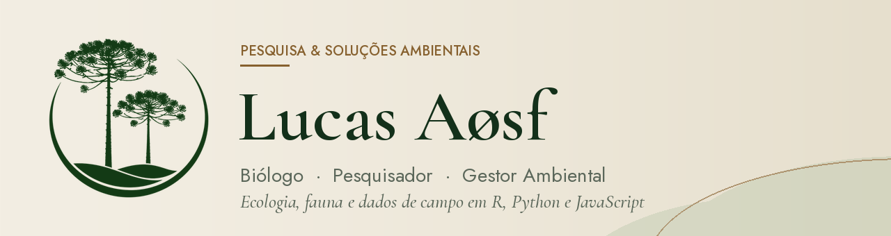

<picture>
  <source media="(prefers-color-scheme: dark)" srcset="assets/banner-escuro.png">
  
</picture>

  
  
  
  
  
  

## 🐸 Sobre mim

Sou biólogo, pesquisador, gestor ambiental, indie maker e programador entusiasta. Trabalho com levantamentos de fauna, ecologia e taxonomia, e uso programação para transformar dados de campo em análises, gráficos, relatórios e para criar ferramentas que facilitam o trabalho de campo.

- Levantamento e monitoramento de fauna
- Ecologia de comunidades: riqueza, abundância, diversidade, similaridade e rarefação
- Distribuição de espécies e bases de biodiversidade (GBIF, eBird)
- Automação de relatórios e ferramentas para o campo

## 💻 Linguagens

  
  
  
  
  
  

| Linguagem | Para que uso | Onde |
|---|---|---|
| **R** | Análises ecológicas e gráficos: riqueza, abundância, similaridade (Jaccard, Bray-Curtis), rarefação e dados do GBIF | [consultoria_ambiental](https://github.com/lucasaosf/consultoria_ambiental) · [IMBio](https://github.com/lucasaosf/IMBio---Instituto-de-Manejo-da-Biodiversidade) · [M_moreirae_distribution](https://github.com/lucasaosf/M_moreirae_distribution) |
| **JavaScript** | App Lista de Campo, banco de espécies e gerador de planilhas Excel com análises | [caderneta-de-campo](https://github.com/lucasaosf/caderneta-de-campo) |
| **HTML e CSS** | Interface do app e páginas na identidade visual da empresa | [caderneta-de-campo](https://github.com/lucasaosf/caderneta-de-campo) |
| **Java** | Código nativo da versão Android do app | versão Android (repositório privado) |
| **Python** | Organização e automação de dados | projetos locais |

**Pacotes de R que uso:** `ggplot2` · `vegan` · `iNEXT` · `rgbif` · `dplyr` · `readr` · `readxl` · `openxlsx` · `cluster` · `ape` · `gridExtra`

## 🧰 Ferramentas

  
  
  
  
  
  
  
  
  

## 🐍 Projeto em destaque: Lista de Campo

App de listas de espécies para o trabalho de campo: banco com **4.903 espécies do Brasil**, apelidos ligados ao nome científico, contagem com registro visual ou auditivo, trilha GPS e **planilha de análises automática** (riqueza, diversidade, rarefação, similaridade, IPA). Funciona sem internet, no Android e no iPhone.

**[Abrir o app](https://lucasaosf.github.io/caderneta-de-campo/)** · **[Vídeo: como usar](https://lucasaosf.github.io/caderneta-de-campo/como-usar.html)** · [Código](https://github.com/lucasaosf/caderneta-de-campo)

## 📂 Outros projetos

| Projeto | O que faz | Linguagem |
|---|---|---|
| [**consultoria_ambiental**](https://github.com/lucasaosf/consultoria_ambiental) | Riqueza e abundância por ponto, similaridade (Jaccard e Bray-Curtis) e conversão de planilhas do eBird para relatórios ambientais | R |
| [**IMBio**](https://github.com/lucasaosf/IMBio---Instituto-de-Manejo-da-Biodiversidade) | Gráficos para o Instituto de Manejo da Biodiversidade (banner da COP30): temperatura no parque reflorestado × entorno e aumento da riqueza de aves no Parque das Nascentes (2019–2024) | R |
| [**M_moreirae_distribution**](https://github.com/lucasaosf/M_moreirae_distribution) | Download das ocorrências de *Melanophryniscus moreirae* no GBIF para estudo de distribuição | R |

---

<i>Pesquisa &amp; Soluções Ambientais</i> · ciência aplicada à conservação

