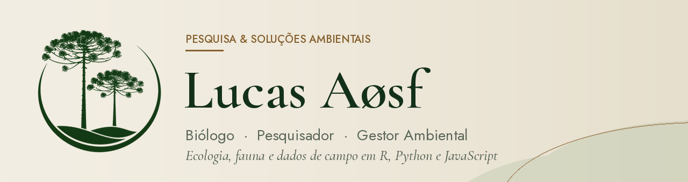
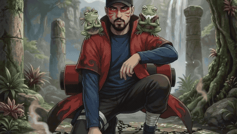

<picture>
  <source media="(prefers-color-scheme: dark)" srcset="assets/banner-escuro.png">
  
</picture>

  
  
  
  
  
  
  
  

  🌐 <b>Idioma / Language:</b>
  <a href="README.md"><b>🇺🇸 Read in English</b></a> ·
  <b>🇧🇷 Português (Brasil)</b>

## 📊 Status no GitHub // @lucasaosf

  

## 🐸 Sobre mim

Sou **biólogo, pesquisador, gestor ambiental, indie maker e programador entusiasta**. Trabalho com levantamentos de fauna, história natural e taxonomia. Utilizo biologia computacional, ciência de dados e tecnologias web modernas para transformar dados brutos de campo em modelos estatísticos multivariados, diagnósticos técnicos e aplicativos offline-first para equipes de campo.

- 🌿 **Levantamento e monitoramento de fauna silvestre** em grandes obras rodoviárias, solares, hidrelétricas e mineração
- 🔬 **Taxonomia, Sistemática & Evolução** (especialista em Anfíbios Anuros e Répteis; ampla experiência com médios/grandes mamíferos e aves)
- 📈 **Ecologia de comunidades**: riqueza, abundância, diversidade (Shannon, Simpson), similaridade (Jaccard, Bray-Curtis) e curvas de rarefação
- 🗺️ **Modelagem biogeográfica e bases globais de biodiversidade** (mineração de ocorrências no GBIF com o pacote R `rgbif` e eBird)
- 💻 **Automação ambiental e engenharia de softwares de campo**: Progressive Web Apps (PWAs) projetados para funcionar 100% offline em áreas remotas

---

## 💻 Linguagens de Programação

  
  
  
  
  
  

| Linguagem | Principais Aplicações | Onde |
|---|---|---|
| **R** | Análises estatísticas ecológicas multivariadas e bioacústica: riqueza, abundância, similaridade (Jaccard, Bray-Curtis), rarefação e dados do GBIF | [consultoria_ambiental](https://github.com/lucasaosf/consultoria_ambiental) · [IMBio](https://github.com/lucasaosf/IMBio---Instituto-de-Manejo-da-Biodiversidade) · [M_moreirae_distribution](https://github.com/lucasaosf/M_moreirae_distribution) |
| **JavaScript** | PWAs offline-first (*Caderneta de Campo* e *Cubagem Florestal*), catálogos botânicos e faunísticos, GPS e planilhas Excel automatizadas | [caderneta-de-campo](https://github.com/lucasaosf/caderneta-de-campo) · [cubagem-florestal](https://github.com/lucasaosf/cubagem-florestal) |
| **HTML e CSS** | Interfaces responsivas, design system em glassmorphism e identidade visual biológica dark/light | [caderneta-de-campo](https://github.com/lucasaosf/caderneta-de-campo) · [cubagem-florestal](https://github.com/lucasaosf/cubagem-florestal) |
| **Java** | Integração nativa Android para aplicações de campo | versão nativa Android (repositório privado) |
| **Python** | Pipelines de ETL ambiental, automação de sistema operacional e agentes locais de IA | [robson-assistant-teste](https://github.com/lucasaosf/robson-assistant-teste) · scripts locais |

**Pacotes de R que uso ativamente:** `ggplot2` · `vegan` · `iNEXT` · `rgbif` · `dplyr` · `readr` · `readxl` · `openxlsx` · `cluster` · `ape` · `gridExtra`

---

## 🧰 Ferramentas & Plataformas

  
  
  
  
  
  
  
  
  

---

## 🐍 Projeto em Destaque: Caderneta de Campo (PWA)

Aplicativo Progressive Web App (PWA) completo para levantamento e monitoramento de fauna e flora em operações de campo: banco de dados taxonômico nativo com **4.903 espécies brasileiras**, nomes populares vinculados ao binômio científico, contagem com registro visual e auditivo, rastreamento por trilhas GPS e **geração automática de planilhas de análise técnica em Excel** (riqueza, diversidade, rarefação, similaridade, Índice Pontual de Abundância - IPA). Funciona **100% offline** no Android e iPhone.

**[🚀 Abrir o Aplicativo](https://lucasaosf.github.io/caderneta-de-campo/)** · **[🎥 Vídeo: Como Usar](https://lucasaosf.github.io/caderneta-de-campo/como-usar.html)** · **[📂 Código-Fonte](https://github.com/lucasaosf/caderneta-de-campo)**

---

## 🪵 Projeto em Destaque: Cubagem Florestal Smalian Pro

Ferramenta digital de engenharia florestal e dendrometria para trabalho em campo: cálculo volumétrico rigoroso para caminhões florestais (fatores de empilhamento e cubicação LE/LD), pilhas de madeira de face única e toras individuais pela **Fórmula de Smalian**. Inclui catálogo dendrológico brasileiro de espécies nativas e exóticas, coordenadas geográficas UTM com GPS do dispositivo e **exportação padronizada instantânea em planilhas Excel (.xlsx)**. Funciona **100% offline** no Android e iPhone.

**[🚀 Abrir o Aplicativo](https://lucasaosf.github.io/cubagem-florestal/)** · **[📂 Código-Fonte](https://github.com/lucasaosf/cubagem-florestal)**

---

## 📂 Outros Projetos & Repositórios

| Projeto | O que faz | Stack |
|---|---|---|
| [**consultoria_ambiental**](https://github.com/lucasaosf/consultoria_ambiental) | Scripts em R para diagnósticos de licenciamento ambiental: riqueza e abundância por ponto amostral, matrizes de similaridade (Jaccard e Bray-Curtis) e conversores para eBird | R |
| [**IMBio**](https://github.com/lucasaosf/IMBio---Instituto-de-Manejo-da-Biodiversidade) | Análise ecológica temporal (2019–2024) apresentada na **COP30 da ONU**: comprovação de que o reflorestamento reduziu a temperatura de superfície e elevou a riqueza de aves de 42 para 131 espécies | R |
| [**M_moreirae_distribution**](https://github.com/lucasaosf/M_moreirae_distribution) | Pipeline automatizado em R para mineração de ocorrências georreferenciadas de *Melanophryniscus moreirae* no GBIF, fundamentando artigo científico aceito em periódico internacional | R |
| [**robson-assistant-teste**](https://github.com/lucasaosf/robson-assistant-teste) | [PoC / Teste] Prova de conceito experimental de assistente virtual autônomo local em Python com LLMs via Ollama, automação de Windows e bot com voz neural no Discord | Python |

---

---

  

  <em>&ldquo;A verdadeira conservação começa no chão da mata, reconhecendo cada espécie por sua voz e sua identidade. Quando unimos o rigor da taxonomia clássica à inteligência dos dados e da gestão ambiental, transformamos o conhecimento científico em legado para a biodiversidade.&rdquo;</em> 
  &mdash; <strong>Lucas Aøsf</strong>, Biólogo, Gestor Ambiental &amp; Sócio Fundador da BioKuri

<i>BIOKURI · Pesquisa e Soluções Ambientais</i> · ciência aplicada à conservação

